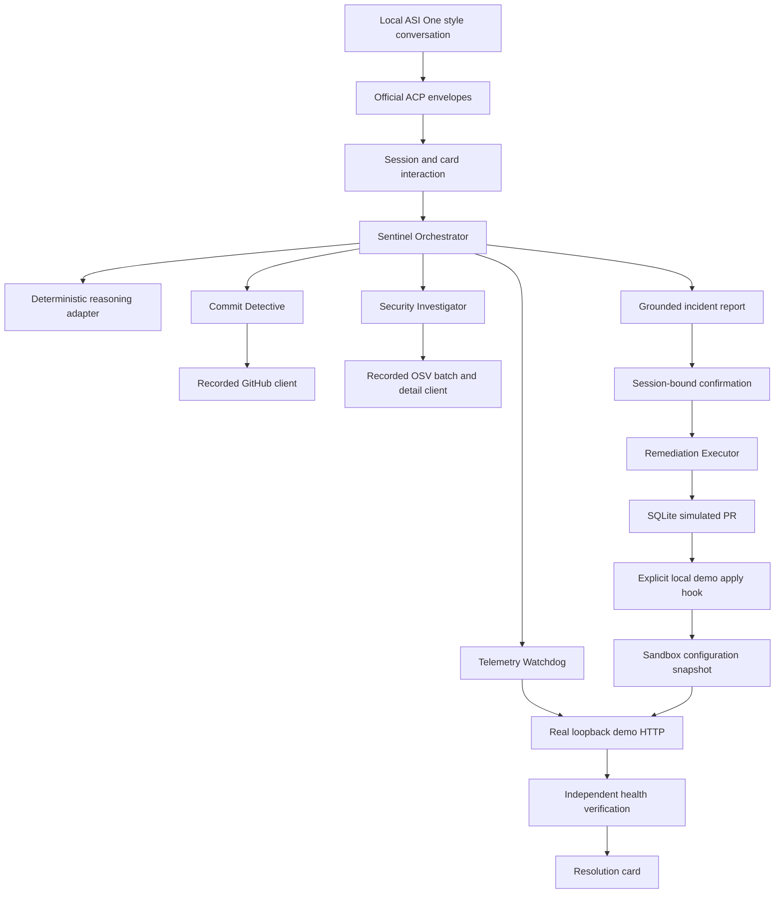

# Local architecture

This build completes Prompts 1–5 only. All five roles are independent Python components
using shared typed contracts. No deployment or publication is attempted.

## Boundaries

- Application messages carry investigation UUIDs. ACP keeps its official schema;
  the gateway maps sender/session to investigation in SQLite.
- The local worker transport serializes and validates messages, correlates responses,
  bounds duration, retries transient failures once with jitter, and applies a cooldown
  after repeated transport timeout. Health and Git analysis run concurrently.
- `ReasoningClient` separates intent/synthesis from transport. Its implementation is
  explicitly simulated. Report facts are rebuilt from worker evidence and validated
  candidate IDs; unsupported free-form model claims cannot pass through.
- `HealthClient`, `GitHubClient`, `OSVClient`, and `PullRequestClient` define injectable
  service boundaries. Live provider adapters are intentionally absent in this scope.
- The chat gateway persists intake and deduplicated replies. Its remediation extension
  handles proposal review and approval. No incoming text becomes a shell command.
  Official protocol handlers are constructed without starting a network Agent.
- Cards validate form/detail/review payloads and official ACP metadata. Progress is
  buffered locally, not streamed through ASI:One.

## Persistence and safety

SQLite holds investigation states, chat replies, proposals, approval hashes, expiry,
action results, sandbox files and PRs. Unique action keys prevent duplicates.
`BEGIN IMMEDIATE` serializes baseline checks and snapshot updates. After a restart,
execution reconciles an existing PR before returning its result.

Approval binds repository, branch, exact file set, replacement content, baseline
hashes, investigation and session. Mutating the original in-memory proposal cannot
change saved approval. Local confirmation references are anti-replay data, not
external credentials. JSON actions and a narrow identifier-complete prose form are
supported; arbitrary planner prose still needs future live validation.

PR creation moves to `verifying` while health still returns 503. A separate explicit
demo hook applies the local snapshot, then the same probe policy independently checks
HTTP 200. Failed verification cannot yield `resolved`. No Git branch is pushed or merged.

## Evidence

The fixture SHA beginning `bbbbbbbb` represents a synthetic bad configuration change,
not a real Git commit. `DEMO-2026-001` is a fictional advisory for a never-installed
package. OSV-shaped batch IDs resolve to full records containing affected ranges,
aliases, references and fixed versions. No fixture is represented as live success.

Security severity is independent of incident likelihood. Findings are not causal
merely because they share a commit. Partial failures retain usable evidence and
warnings. This is a bounded local system, not a full scanner or deployed agent fleet.
